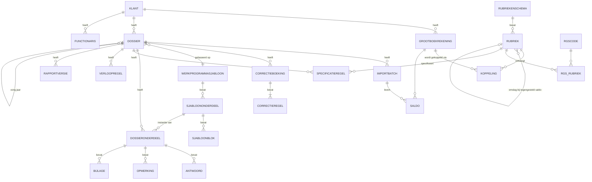

# 6. Datamodel

> **Aanvulling 23-10-2026:** het datamodel voor materialiteit, posten en stappen staat in [§10.5](10-werkprogramma-en-materialiteit.md#105-uitbreiding-datamodel). De gegevens die de rapporten extra nodig hebben (statuten, fiscale eenheid, aandelenkapitaal, fte en historie) staan in [§9.4](09-analyse-voorbeeldrapporten.md#94-gegevens-die-we-nodig-hebben-naast-de-proefbalans).

> Dit is een logisch model: de entiteiten en hun relaties, op het niveau dat nodig is om te
> bouwen. Veldnamen zijn Nederlands, zodat ze aansluiten op de vaktaal. Het fysieke model
> (EF Core) volgt hieruit.

## 6.1 Drie niveaus

Het model kent drie niveaus. Dit verklaart ook hoe Visionplanner zich gedraagt
(koppelingen "rollen door" naar volgend jaar, sjablonen gelden voor alle klanten):

| Niveau | Wat leeft hier | Levensduur |
|---|---|---|
| **Kantoor** (beheer) | Gebruikers, rubriekenschema's, RGS-referentietabel, RGS→rubriek-tabel, koppelsjablonen per boekhoudpakket, werkprogrammasjablonen, standaardteksten, rapportsjablonen, huisstijl | Versies; wijzigingen gelden voor *nieuwe* dossiers |
| **Klant** | Klantgegevens, functionarissen en vennoten, het rekeningschema van de klant (grootboekrekeningen) en de **koppelingen** rekening→rubriek | Doorlopend over alle boekjaren |
| **Dossier** (klant × boekjaar × opdracht) | Imports en saldi, correctieboekingen, werkprogramma-uitvoering, specificaties, verloopoverzichten, opmerkingen, bijlagen, rapportteksten en rapportversies | Eén boekjaar. Wordt gesloten en daarna alleen-lezen |

## 6.2 Diagram

## 6.3 Entiteiten

### Kantoorniveau

**Gebruiker** (ASP.NET Core Identity): Id, Gebruikersnaam, Naam, Initialen, Titel (bijv. AA/RA), Wachtwoordhash, Lockout, 2FA-gegevens, Rollen (`Medewerker`, `Reviewer`, `Accountant`, `Beheerder`), HandtekeningAfbeelding (alleen tekenbevoegden), Actief, MoetWachtwoordWijzigen.

**Rubriekenschema** (= Visionplanners "rapportagestructuur"): Id, Naam (bijv. *BV klein*, *IB-ondernemer*, *Stichting*), Versie, Status (`Concept`/`Actief`/`Vervallen`).

**Rubriek**: Id, SchemaId, OuderId (boomstructuur), Code, Naam, Soort (`Balans`/`WinstEnVerlies`), Zijde (`Activa`/`Passiva`/`Opbrengsten`/`Kosten`), NormaalSaldo (`D`/`C`), Volgorde, Niveau, **OmslagRubriekId** (waar het saldo heen gaat als het de "verkeerde" kant op staat, bijv. *Bank* debet → *Liquide middelen*, credit → *Schulden aan kredietinstellingen*), SpecificatieVerplicht, VerloopoverzichtType (`Geen`/`VasteActiva`/`EigenVermogen`/`Voorziening`/`LanglopendeSchuld`), RapportLabel(s) per rapportvariant, *(toekomst)* NT-taxonomieconcept voor SBR.

**RgsCode** (referentietabel, per RGS-versie): Referentiecode (bijv. `BIvaKou`), Referentienummer, Omschrijving (kort/lang), Niveau, OuderCode, D/C, Sortering, Filterkenmerken (bijv. van toepassing op ZZP/EZ/BV), RGS-versie.

**RgsRubriekKoppeling**: SchemaId, RgsCode, RubriekId. Hoe specifieker de RGS-code, hoe hoger de voorrang (zie [hoofdstuk 4](04-rubricering-ontwerp.md)).

**Koppelsjabloon** (kantoorkoppeling per boekhoudpakket of standaard rekeningschema): Id, Naam (bijv. *SnelStart standaard*, *Exact MKB-schema*), regels: RekeningnummerVan/Tot of exact nummer, optioneel een omschrijvingspatroon, RubriekId.

**Werkprogrammasjabloon**: Id, Naam, AardOpdracht (bijv. `Samenstellen`, `Aangifte plus`), Versie, Status.

**SjabloonOnderdeel**: Id, SjabloonId, OuderId (fase → sectie → onderdeel), Titel, Fase (`Profiel`, `Voorbereiding`, `Uitvoering`, `Rapport`, `Afronding`), **Verplicht** (het `*` in Visionplanner), Volgorde, **Conditie** (expressie, bijv. `klant.rechtsvorm == "BV"`, `rubriek("MVA").saldo != 0`), Gekoppelde rubrieken (voor de cijfertabel), Verwijzing naar regelgeving (bijv. NV COS 4410 alinea).

**SjabloonBlok**: Id, OnderdeelId, Type (`Toelichting`, `Vraag`, `Keuzevraag`, `Werkprogrammastap`, `Cijferbeoordeling`, `Verloopoverzicht`, `Specificatie`, `Bijlageverzoek`), Tekst, Standaardantwoord(en), Volgorde, Conditie.

**Standaardtekst**: Id, Categorie (samenstellingsverklaring, grondslagen, toelichting, brieven, …), Titel, Inhoud (Liquid-sjabloon met variabelen en voorwaarden), Versie, Geldig voor (rechtsvorm/grootte/opdracht).

**Rapportsjabloon / Rapportsectie**: Id, Naam, Versie; secties met Type (`Tekst`, `Balans`, `WinstEnVerlies`, `Toelichting per rubriek`, `Specificaties`, `Kengetallen`, `Fiscale positie`, `Inhoudsopgave`, `Voorblad`), Volgorde, Conditie, verwijzing naar standaardtekst(en).

### Klantniveau

**Klant**: Id, Klantnummer, Naam, Rechtsvorm (`BV`, `NV`, `Eenmanszaak`, `VOF`, `Maatschap`, `CV`, `Stichting`, `Vereniging`, `Coöperatie`), KvK-nummer, RSIN/fiscaal nummer, Adres, SBI-code/activiteit, **Grootte** (`Micro`/`Klein`/`Middelgroot`, met de criteria uit BW2 als controle), BoekjaarEindeMaand, Verantwoordelijke (accountant), Medewerker, Wwft-risicoprofiel, Status.

**Functionaris**: Naam, Rol (`Bestuurder`, `Commissaris`, `Vennoot`, `UBO`, `Contactpersoon`), Winstaandeel % (bij VOF/maatschap), Van/Tot.

**Grootboekrekening**: Id, KlantId, Nummer, Omschrijving, BalansOfWV (uit de import), RgsCode (als de bron die meelevert), Actief. *Sleutel = (KlantId, Nummer).* Bij een herimport koppelen we hierop terug.

**Koppeling**: Id, KlantId, GrootboekrekeningId, RubriekId, **Bron** (`Handmatig`, `Klant-vorig-jaar`, `RGS`, `Koppelsjabloon`, `Voorstel`), **Status** (`Voorgesteld`/`Bevestigd`), GeldigVanafBoekjaar, BevestigdDoor/Op.
Optioneel *KoppelingSplitsing*: een rekening verdeeld over meerdere rubrieken (percentage of vast bedrag). Gebruik dit spaarzaam; een correctieboeking (herrubricering) is meestal transparanter.

### Dossierniveau

**Dossier**: Id, KlantId, Naam (bijv. "Financieel rapport 2024"), Boekjaar, Begindatum, Einddatum, AardOpdracht, WerkprogrammasjabloonId + versie, RapportsjabloonId + versie, RubriekenschemaId + versie, **Status** (`Nieuw` → `In uitvoering` → `Ter review` → `Rapport uitgebracht` → `Gesloten`), VorigDossierId, UitgebrachtOp, GeslotenOp, GeslotenDoor.

**ImportBatch**: Id, DossierId, Bestandsnaam, SHA-256, Type (`XAF`, `Excel`, `CSV`, `Handmatig`), Pakket (uit XAF-header), Versie, Periode van/tot, GeïmporteerdOp/Door, Controletotalen (debet = credit, aantallen), Actief (de nieuwste batch is leidend; oudere blijven bewaard voor de historie).

**Saldo**: ImportBatchId, GrootboekrekeningId, Periode (`0` = beginbalans, `1..12`, eventueel `13` = afsluiting), Debet, Credit. Het eindsaldo is afgeleid.

**Mutatie** (optioneel, voor drill-down vanuit een rubriek naar boekingen): ImportBatchId, GrootboekrekeningId, Dagboek, Boekstuknummer, Datum, Omschrijving, Bedrag, D/C, Relatie.

**Correctieboeking** (memoriaal in het dossier): Id, DossierId, Nummer, Datum, Omschrijving, Soort (`Correctie`, `Herrubricering`, `Fiscale correctie`, `Terugkerend`), Status (`Concept`/`Verwerkt`), DoorgevoerdInAdministratieKlant (ja/nee, zodat je kunt bijhouden of de klant de boeking zelf ook verwerkt). Regels: GrootboekrekeningId, Bedrag (+ debet / − credit), Omschrijving. **Validatie: de som van de regels is altijd 0.**

**Planning** (kolom *Planning* in de cijferbeoordeling): DossierId, RubriekId, Bedrag (verwachting, begroting of vorig jaar), Materialiteit/drempel voor delta-signalering.

**DossierOnderdeel**: Id, DossierId, SjabloonOnderdeelId, Status (`Open`, `Gereed`, `Goedgekeurd`, `Niet van toepassing`), UitgevoerdDoor/Op, **GoedgekeurdDoor/Op**, Vergrendeld.

**Antwoord**: DossierOnderdeelId, SjabloonBlokId, Tekst (rich text), Keuze, Afgevinkt, Initialen/Datum, VrijeNotitie.

**Opmerking** (reviewpunt): DossierOnderdeelId, Tekst, Door/Op, Status (`Open`/`Opgelost`), OpgelostDoor/Op. *Een onderdeel kan pas worden goedgekeurd als er geen open reviewpunten meer zijn.*

**Bijlage**: Id, DossierId, DossierOnderdeelId (optioneel), Hash, OrigineleNaam, Omschrijving, Door/Op.

**Specificatieregel**: DossierId, RubriekId, Omschrijving, BedragHuidig, BedragVorig, **ToonInRapport**, Volgorde, Subkop. *Controle: de som van de specificatieregels moet gelijk zijn aan het rubrieksaldo.*

**Verloopregel** (verloopoverzicht IVA, MVA, FVA, eigen vermogen, voorzieningen, langlopende schulden): DossierId, RubriekId, Omschrijving/Activum, Kolommen (Aanschafwaarde begin, Cumulatieve afschrijving begin, Investeringen, Desinvesteringen, Afschrijvingen, Afschrijvingspercentage, …). *Controle: het eindsaldo van het verloopoverzicht moet gelijk zijn aan het balanssaldo.*

**RapportTekst**: DossierId, RapportsectieId, Inhoud (dossierspecifieke aanpassing van een standaardtekst), Bron (standaardtekst-id en -versie).

**Rapportversie**: DossierId, Volgnummer, Status (`Concept`/`Definitief`), PDF-hash, AangemaaktDoor/Op.

**Taak**: KlantId/DossierId, Omschrijving, Toegewezen aan, Deadline, Status. Voedt de kolom *Open taken* in de klantenmonitor.

**AuditLog**: Tijdstip, Gebruiker, Entiteit, EntiteitId, Actie, OudeWaarde, NieuweWaarde (JSON).

## 6.4 Tekenconventie en afgeleide gegevens

- **Opslag:** debet = positief, credit = negatief, in eurocenten.
- **Proefbalans in evenwicht:** Σ alle saldi = 0.
- **Resultaat** = −Σ saldi van W&V-rekeningen (een creditsaldo is winst).
- **Weergave per rubriek** volgt het *NormaalSaldo*: activa en kosten als debet-positief, passiva en opbrengsten als credit-positief.

**Afgeleide proefbalans per dossier** (de tabel uit de schermafbeelding *Aanpak en cijferbeoordeling*):

| Kolom | Berekening |
|---|---|
| Saldo administratie | Beginsaldo + Σ mutaties t/m laatste periode (actieve importbatch) |
| Correcties | Σ correctieregels op deze rekening |
| **Huidig** | Saldo administratie + Correcties |
| **Vorig** | *Huidig* uit het (gesloten) dossier van vorig jaar, of bij het eerste jaar een aparte import of handmatige invoer |
| **Planning** | Uit tabel Planning |
| **Delta** | Huidig − Vorig (en/of Huidig − Planning), absoluut en in %, gemarkeerd als het boven de drempel uitkomt |

Rubrieksaldi zijn de som van de rekeningen per rubriek, opgeteld via de boom (rollup).
Een rekening met een **omslagrubriek** wordt per dossier toegewezen op basis van het teken van het saldo (debet of credit). Dat gebeurt op rekeningniveau, of als het rubriekenschema dat voorschrijft, op het niveau van het rubriektotaal.
